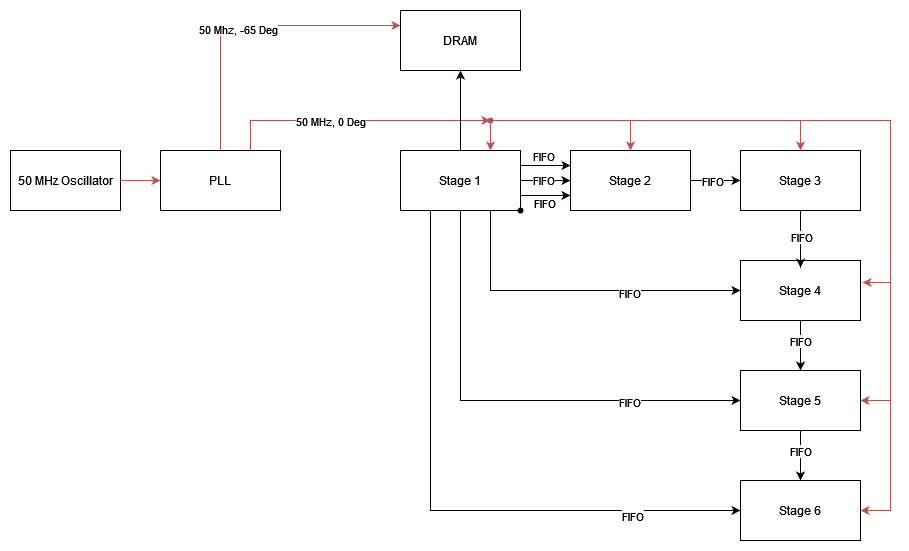
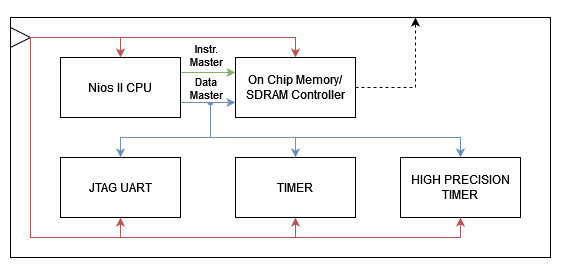
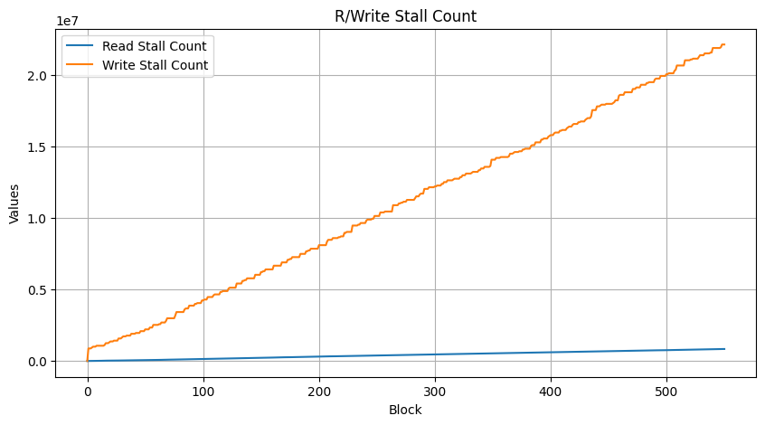
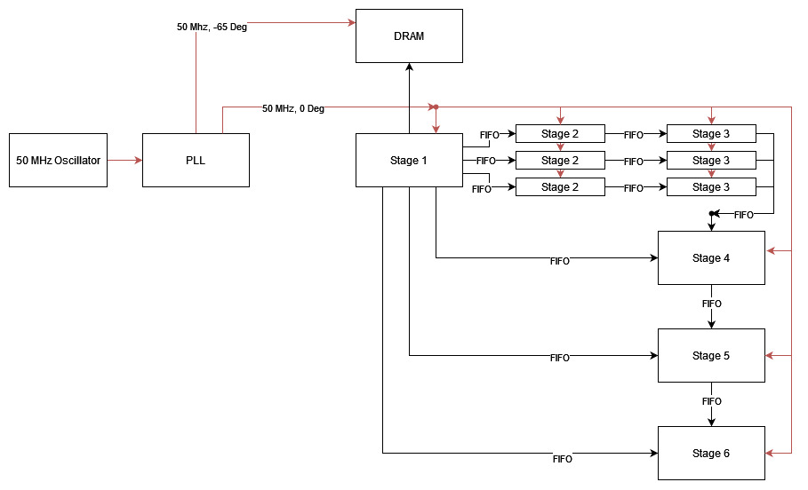
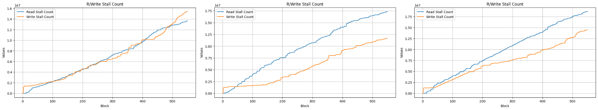
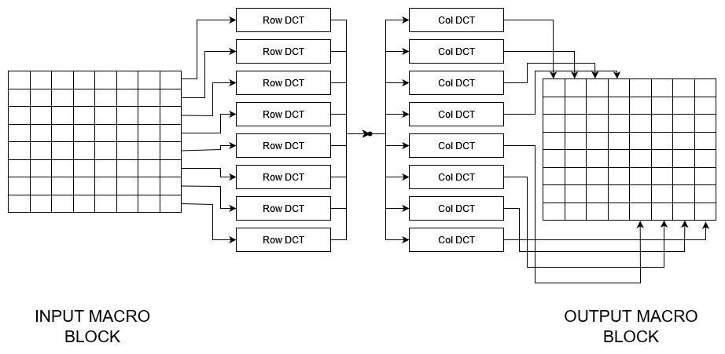
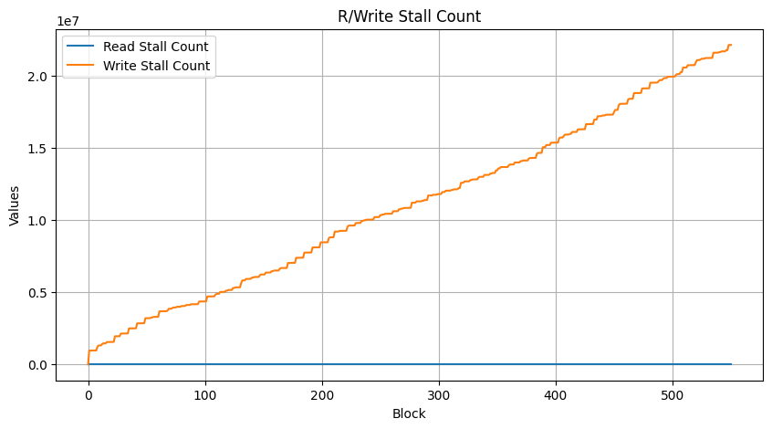
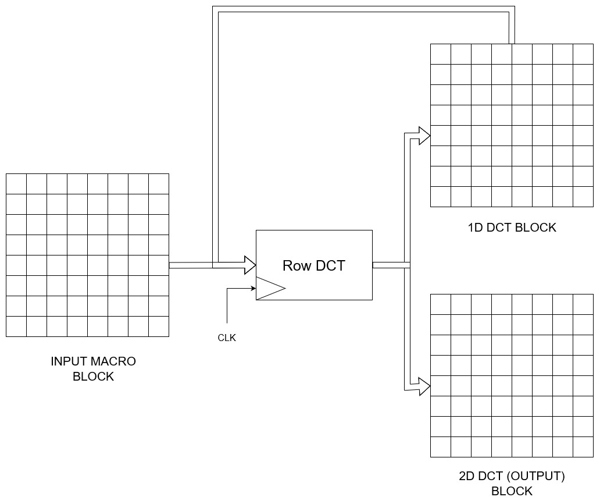

This was one of the labs for CO503 (Advanced Embedded Systems) during my undergrad in the Department of Computer Engineering at the University of Peradeniya. My lab partner and I took a software JPEG encoder and split it across a multiprocessor system-on-chip (MPSoC) on an Intel (Altera) Cyclone IV E FPGA (EP4CE115). Each stage of the encoder got its own Nios II soft-core CPU, and the stages passed data to each other through hardware FIFOs.

Getting it to produce a valid JPEG was the easy part. Most of the work went into measuring the pipeline, finding the slowest stage, and making it faster. Our first idea for that didn't work.

## The pipeline

JPEG encoding splits naturally into stages, so we gave each stage its own processor:

| Stage | Job |
|---|---|
| 1 | Read the raw YUV image from storage and split it into 8×8 macroblocks |
| 2 | Level shift (subtract 128 from every sample) |
| 3 | 2D Discrete Cosine Transform (DCT) |
| 4 | Quantization and zig-zag reordering |
| 5 | Huffman encoding |
| 6 | Write the JPEG file |


*The baseline MPSoC. Each stage is a Nios II CPU, connected to its neighbours by FIFOs. Stage 1 also has direct channels to stages 4, 5 and 6, which it uses to send metadata such as the block count, quality factor and image dimensions.*

Each stage was a small self-contained subsystem: a Nios II CPU, its own memory, a JTAG UART for logging, a system timer and a high-precision timer for measurements.


*The building block repeated for each stage.*

Memory was tight. Stage 1 has to hold the whole raw image, so it got the off-chip SDRAM. Every other stage ran from on-chip memory. To make the binaries fit, stages 2–5 were built against the reduced ("small") C library:

| Stage | On-chip memory (KB) |
|---|---|
| 2 | 12 |
| 3 | 17.8 |
| 4 | 12 |
| 5 | 32 |
| 6 | 100 |

## Measuring a pipeline

In a pipeline, a stage's work time doesn't tell you much by itself. What matters is how long each stage spends waiting. Every stage runs the same loop: read a block from the incoming FIFO, process it, and write it to the outgoing FIFO. So for every block we recorded three things:

- **Read stalls**: how many times the stage tried to read and found the incoming FIFO empty. This means it was waiting on the stage before it.
- **Write stalls**: how many times the stage tried to write and found the outgoing FIFO full. This means it was waiting on the stage after it.
- **Block process time**: wall-clock time for read, process and write, *including* the stalls.

The instrumentation was just counters wrapped around the FIFO polling loops, plus timestamps from the high-precision timer:

```c
// Wait until data is available from the incoming FIFO
while (!altera_avalon_fifo_read_level(IN_CSR_BASE)) {
    read_stall_count++;
}
data = altera_avalon_fifo_read_fifo(R_BASE, IN_CSR_BASE);

// ... process the block ...

// Keep trying to write until the outgoing FIFO accepts it
while (altera_avalon_fifo_write_fifo(W_BASE, OUT_CSR_BASE, data)
       != ALTERA_AVALON_FIFO_OK) {
    write_stall_count++;
}
```

```c
while (1) {
    read_stall_count = 0;
    write_stall_count = 0;
    time_start = alt_timestamp();

    process_block();

    time_end = alt_timestamp();
    // Elapsed time in microseconds
    result = ((long double)(time_end - time_start)) /
             ((unsigned long long)alt_timestamp_freq() / 1000000);
}
```

Each CPU printed its numbers over JTAG UART. We pulled the logs into a Jupyter notebook to plot them.

## Baseline results

The pipeline worked, and this image came out the other end:


*The encoded output.*

These were the per-block numbers:

| Stage | Avg. block time (ms) | Avg. read stalls | Avg. write stalls |
|---|---|---|---|
| 1 | 47.15 | – | 12,957 |
| 2 | 24.70 | 417,873 | 11,073,667 |
| 3 | 28.47 | 28,656 | 18,843 |
| 4 | 27.64 | 33,759 | 13,389 |
| 5 | 25.70 | 49,860 | 5,032 |

The one-off costs were much bigger than any of these: reading the input file in stage 1 took **17.6 s**, setting up the quantization tables in stage 4 took **1.07 s**, and writing the output file in stage 6 took **29.7 s**. File I/O was painfully slow. We couldn't do much about that, so we focused on throughput per block.

### Stage 3 is the bottleneck, and stage 2 shows it

Stage 2 only subtracts 128 from each sample, yet its block time (24.70 ms) is close to stage 3's (28.47 ms). That's because block time includes stalls. A fast stage sitting in front of a slow one spends most of its time unable to hand off its output. In a pipeline, every stage ends up running at the speed of the slowest one.

Stage 2's stall counts show this clearly. Its write stalls grow steadily with every block, because stage 3 keeps falling further behind:


*Cumulative stall counts for stage 2. The write stalls (orange) keep climbing, so stage 2 is mostly waiting for stage 3.*

So the target was the DCT stage.

## Quick win: a data cache for stage 1

First we added a 32 KB data cache to the stage 1 CPU, which reads from slow off-chip SDRAM. Its block time dropped from **47.15 ms to 31.3 ms**. Its write stalls also rose from 12,957 to 38,780. That fits the theory: stage 1 now produced data faster than the rest of the pipeline could take it.

## Attempt 1: more CPUs (didn't work)

Our first idea for the DCT stage was to throw more cores at it. We built three parallel stage 2 → stage 3 lanes and had stage 1 spread the blocks across them. Stage 4 merged the three lanes back into one stream.


*The superscalar variant: three level-shift CPUs and three DCT CPUs running in parallel.*

| Stage | CPU | Avg. block time (ms) | Avg. read stalls | Avg. write stalls |
|---|---|---|---|---|
| 1 | | 52.13 | – | 47,788 |
| 2 | 1 | 25.33 | 6,657,956 | 6,697,537 |
| 2 | 2 | 23.99 | 9,654,687 | 5,605,050 |
| 2 | 3 | 30.24 | 9,848,377 | 7,243,273 |
| 3 | 1 | 30.72 | 41,440 | 18,177 |
| 3 | 2 | 37.16 | 45,490 | 22,199 |
| 3 | 3 | 31.34 | 34,469 | 20,702 |
| 4 | | 28.40 | 42,862 | 14,431 |
| 5 | | 32.16 | 69,125 | 4,710 |


*Stall counts for stage 2 CPUs 1–3 (left to right). Read and write stalls now grow together.*

Nothing got meaningfully faster, and most stages got slightly *slower*. The stage 2 CPUs now spent as much time waiting for input as waiting to write output, so the extra lanes were starved as well as blocked. Each DCT CPU still took about as long per block as before. A soft-core computing a 2D DCT in software is just slow, and three slow cores fed by one stage 1 and merged into one stage 4 didn't add up to a fast stage.

## Attempt 2: a DCT hardware accelerator

So we took the DCT out of software. We wrote a Verilog accelerator and attached it to the stage 3 Nios II as a **custom instruction**. The opcode extension `n` selects the operation: `n` = 0–63 writes pixel `n` into the accelerator, and `n` = 64–127 reads back DCT coefficient `n − 64`.


*The accelerator: eight row-DCT units feed eight column-DCT units, all purely combinational.*

A 2D DCT can be split into two passes of 1D DCTs: one over each row, then one over each column. The accelerator does exactly that, with 16 instances of a 1D DCT unit wired back to back. Each unit uses the usual even/odd butterfly decomposition with fixed-point cosine constants scaled by 2¹⁰ (for example, `1420 ≈ cos(π/16)·√2·1024`). This is a lightly condensed version of the unit:

```verilog
module DCT_Accelerator_Component #(
    parameter signed [15:0] s1 = 16'sd0,   // shift for the DC/even terms
    parameter signed [15:0] s2 = 16'sd0    // shift for the multiplied terms
)( input  signed [15:0] x0, x1, x2, x3, x4, x5, x6, x7,
   output signed [15:0] y0, y1, y2, y3, y4, y5, y6, y7 );

    localparam signed [15:0] c1 = 16'sd1420; // cos( PI/16) * sqrt(2)
    localparam signed [15:0] c2 = 16'sd1338; // cos( PI/8 ) * sqrt(2)
    localparam signed [15:0] c3 = 16'sd1204; // cos(3PI/16) * sqrt(2)
    localparam signed [15:0] c5 = 16'sd805;  // cos(5PI/16) * sqrt(2)
    localparam signed [15:0] c6 = 16'sd554;  // cos(3PI/8 ) * sqrt(2)
    localparam signed [15:0] c7 = 16'sd283;  // cos(7PI/16) * sqrt(2)

    reg signed [31:0] buff[0:8];
    reg signed [15:0] r[0:7];

    always @(*) begin
        // Butterfly: sums feed the even outputs, differences the odd ones
        buff[8] = x0 + x7;  buff[0] = x0 - x7;
        buff[7] = x1 + x6;  buff[1] = x1 - x6;
        buff[6] = x2 + x5;  buff[2] = x2 - x5;
        buff[5] = x3 + x4;  buff[3] = x3 - x4;

        buff[4] = buff[8] + buff[5];  buff[8] = buff[8] - buff[5];
        buff[5] = buff[7] + buff[6];  buff[7] = buff[7] - buff[6];

        r[0] = (buff[4] + buff[5]) >>> s1;
        r[4] = (buff[4] - buff[5]) >>> s1;
        r[2] = (buff[8]*c2 + buff[7]*c6) >>> s2;
        r[6] = (buff[8]*c6 - buff[7]*c2) >>> s2;
        r[1] = (buff[0]*c1 + buff[1]*c3 + buff[2]*c5 + buff[3]*c7) >>> s2;
        r[3] = (buff[0]*c3 - buff[1]*c7 - buff[2]*c1 - buff[3]*c5) >>> s2;
        r[5] = (buff[0]*c5 - buff[1]*c1 + buff[2]*c7 + buff[3]*c3) >>> s2;
        r[7] = (buff[0]*c7 - buff[1]*c5 + buff[2]*c3 - buff[3]*c1) >>> s2;
    end

    assign {y0, y1, y2, y3, y4, y5, y6, y7} =
           {r[0], r[1], r[2], r[3], r[4], r[5], r[6], r[7]};
endmodule
```

The custom-instruction wrapper holds the 64 input pixels in registers. It instantiates eight of these units with `s1 = 0, s2 = 10` for the row pass, and eight with `s1 = 3, s2 = 13` for the column pass. The column pass reads the row results in transposed order. The shifts undo the 2¹⁰ constant scaling and apply the DCT normalisation.

This time it worked:

| Stage | Avg. block time (ms) | Avg. read stalls | Avg. write stalls |
|---|---|---|---|
| 1 | 31.21 | – | 39,951 |
| 2 | 14.14 | 585 | 11,125,223 |
| 3 | 15.25 | 30,228 | 15,590 |
| 4 | 16.37 | 37,515 | 6,767 |
| 5 | 15.63 | 53,984 | 3,321 |

Stage 3 went from 28.47 ms to 15.25 ms per block. Because block time includes stalls, the whole pipeline sped up with it, and stages 2–5 all came down to about 14–16 ms. Stage 2's read stalls fell from about 418k to 585, so it is now almost never waiting for input.


*Stage 2 with the accelerator in stage 3. Read stalls are near zero, but write stalls still climb.*

Stage 2's write stalls still climb steadily, though. Stage 3 is faster than before but is still the bottleneck.

## What I'd do next

The obvious next step was to combine both ideas: three parallel DCT lanes, each with its own accelerator. That design didn't fit on the FPGA. Each 1D unit does 20 constant multiplications, so one accelerator needs 16 × 20 = 320. Three copies ran past the device's multiplier blocks.

The fix is to trade area for time. Instead of 16 combinational units, use **one** 1D DCT unit and step it through the block over several clock cycles. First run the eight rows into an intermediate buffer, then run the eight columns of that buffer into the output.


*Proposed redesign: a single clocked row-DCT unit, reused for both passes through an intermediate 1D DCT buffer.*

That cuts the multiplier count by 16×, at the cost of about 16 cycles per block instead of one combinational pass. Even then it would still be much faster than software. A smaller accelerator also leaves room for several copies, and that is how you actually remove the bottleneck.

## Takeaways

- **Measure stalls, not just compute time.** In a pipeline, the slowest stage sets every stage's block time. The stall counts on both sides of a stage show where the bottleneck is. Stage 2 told us more about stage 3 than stage 3's own numbers did.
- **Adding more cores doesn't help when each core is the problem.** Replicating a slow software stage added FIFO and scheduling overhead without making any single block faster.
- **Specialized hardware fixed it.** A fairly simple combinational DCT, exposed as a custom instruction, nearly halved the block time.
- **On an FPGA you can run out of space.** The fastest design is useless if it doesn't fit. Choosing between combinational and multi-cycle hardware is a real design decision.
